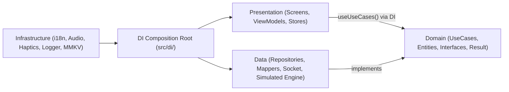
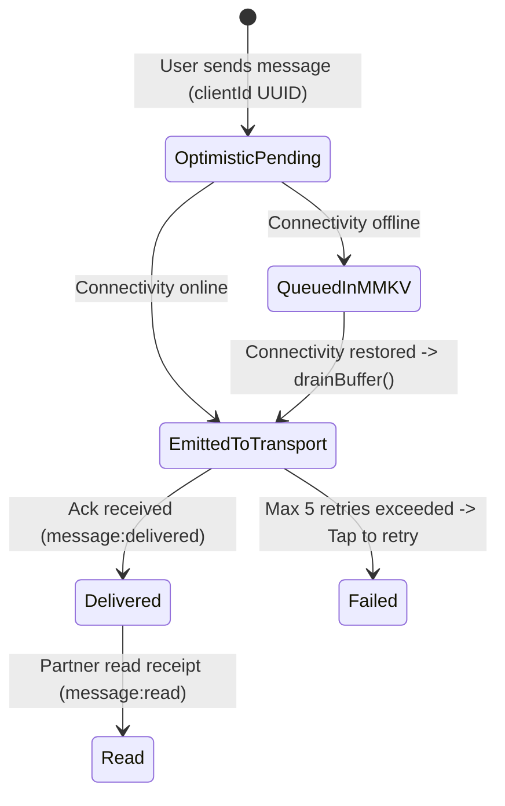

# Chat Roulette — Real-Time Chat Rooms & Instant Roulette Showcase

**A production-grade Expo SDK 58 (React Native 0.88, React 19, New Architecture) real-time messaging & roulette matching showcase built with Strict TypeScript 6, Clean Architecture, MMKV offline outbound queueing, Reanimated 4 motion, and 100% EN/AR RTL parity.**

[](https://github.com/muhammedelnady/chat-roulette/actions/workflows/ci.yml)
[](LICENSE)

---

## 1. Reviewer's Guide (5-Minute Tour)

Run every engineering gate (`prettier`, `tsc --noEmit`, ESLint Clean Architecture layer boundaries, EN/AR i18n parity, DI & Result checks, Symmetry rules, and Jest coverage suite) with one command:

```bash
npm run verify
```

| Concern                                  | Implementation Files                                                                                                                                                                    | Verification / Tests                                                                                                                               |
| :--------------------------------------- | :-------------------------------------------------------------------------------------------------------------------------------------------------------------------------------------- | :------------------------------------------------------------------------------------------------------------------------------------------------- |
| **Clean Architecture & Result Pattern**  | `src/domain/Result.ts`, `src/domain/entities/Chat.ts`, `src/domain/usecases/chat/`                                                                                                      | `src/domain/Result.test.ts`, `src/domain/usecases/chat/ChatUseCases.test.ts`, `scripts/verify-architecture.sh`, `scripts/verify-result-pattern.sh` |
| **Dependency Injection Root**            | `src/di/container.ts`, `src/di/UseCasesProvider.tsx`, `src/di/modules/chatModule.ts`, `src/di/bootstrap.ts`                                                                             | `scripts/verify-di.sh`, `eslint.config.js` (`import/no-restricted-paths`)                                                                          |
| **Offline-First MMKV Outbox**            | `src/data/socket/ChatOutboundQueue.ts`, `src/data/socket/ChatSocketService.ts`, `src/infrastructure/storage/mmkvStorage.ts`                                                             | `src/data/socket/ChatOutboundQueue.test.ts`, `src/data/simulated/SimulatedChatEngine.test.ts`                                                      |
| **Dual-Mode Real-Time Engine**           | `src/data/simulated/SimulatedChatEngine.ts`, `src/data/simulated/SimulatedChatRepositories.ts`, `src/data/repositories/ChatRepositoryImpl.ts`                                           | `src/data/simulated/SimulatedChatEngine.test.ts`, `src/data/mappers/ChatMapper.test.ts`                                                            |
| **Midnight Pulse UI & Showcase Screens** | `src/presentation/theme/colors.ts`, `src/presentation/features/chat/screens/rooms/`, `src/presentation/features/chat/screens/roulette/`, `src/presentation/features/chat/screens/chat/` | `ChatRoomsContent.test.tsx`, `ChatRouletteContent.test.tsx`, `ChatContent.test.tsx`, `AudioMessageBubble.test.tsx`, `ChatMessageBubble.test.tsx`   |
| **Bilingual EN / AR RTL Mirroring**      | `src/infrastructure/i18n/translate.ts`, `src/infrastructure/i18n/langs/en.json`, `src/infrastructure/i18n/langs/ar.json`                                                                | `src/infrastructure/i18n/translate.test.ts`, `scripts/validate-i18n.js`                                                                            |
| **Argent E2E Suite (iOS Simulator)**     | `.argent/e2e/` (`rooms`, `controls`, `roulette`, `chat`, `offline`), `.argent/README.md`, `.github/workflows/e2e-ios.yml`                                                               | `npm run e2e:ios` (12 deterministic YAML tests)                                                                                                    |
| **Symmetry & Security Gates**            | `scripts/check-symmetry.mjs`, `.gitleaks.toml`, `scripts/secret-scan.sh`                                                                                                                | `npm run check:symmetry`, `npm run secret:scan`, `.github/workflows/ci.yml`                                                                        |

---

## 2. Overview & Showcase Highlights

### Built for Instant Demoing (Zero Backend Required)

Recruiters and engineering reviewers can boot the app immediately with `npx expo start` in **Simulated Real-Time Mode** (`EXPO_PUBLIC_CHAT_MODE=simulated`, default) — or flip to a live Socket.IO + REST backend via `.env`.

### Interactive "Midnight Pulse" Controls Built Into the App

1. **Network Offline Simulation Toggle (`Online` / `Offline Sim`):**
   - Flip offline right inside the **Pulse Rooms** header or **Chat Room** header.
   - Outbound messages transition to `PENDING`, persist inside **`ChatOutboundQueue` (MMKV)**, and display a live queued badge.
   - Flipping back to `Online` automatically triggers connectivity observers (`ConnectivityAdapter` -> `SimulatedChatSocketService.drainBuffer()`), flushing queued messages cleanly in FIFO order (`PENDING` -> `DELIVERED` -> `READ`) and receiving simulated live typing & partner replies.
2. **Chat Roulette Radar (`app/rooms/roulette.tsx`):**
   - Topic-filtered instant matching (`React Native`, `System Design`, `AI Agents`, `UI/UX Motion`, `Founders`) powered by Reanimated 4 pulsing radar rings and haptic feedback.
3. **Rich Interactive Chat Room (`app/rooms/[conversationId].tsx`):**
   - **Audio Voice Notes:** Interactive waveform scrubbing, play/pause, and `1x / 1.5x / 2x` speed toggle (`AudioMessageBubble`) plus live microphone recording (`ExpoAudioRecordingService`).
   - **Emoji Reactions:** Long-press any message to open quick reactions (`⚡`, `🔥`, `🚀`, `💜`) or tap existing reaction pills to toggle counts.
   - **Image Attachments & Lightbox:** Multi-image staging tray with upload spinner and full-screen zoomable lightbox.
   - **Live EN / AR RTL & Dark / Light Theme Switching:** Instant one-tap mirroring and theme token re-skinning without reloading.

---

## 3. Clean Architecture & Data Flow



### Offline Outbox Lifecycle



---

## 4. Security & Privacy Posture

- **Zero Secrets Committed:** `.env` files, native keystores, Firebase plists, and build artifacts are strictly gitignored.
- **Automated Secret Scanning:** `.gitleaks.toml` and `.github/workflows/ci.yml` enforce zero credential leaks across both working directory and full git history (`bash scripts/secret-scan.sh`).
- **Secure Storage Separation:** Auth tokens and the MMKV master key use `expo-secure-store` (`WHEN_UNLOCKED_THIS_DEVICE_ONLY`), while high-throughput caches and outbound queues use AES-256 encrypted MMKV (`react-native-mmkv`).
- **Redacted Logging:** `src/infrastructure/logging/logger.ts` automatically redacts sensitive keys (`token`, `authorization`, `secret`, `apiKey`, `cookie`) and Bearer strings before printing.

---

## 5. Getting Started

```bash
# 1. Install dependencies
npm install

# 2. Run the full verification & test suite
npm run verify

# 3. Start Expo development server
npx expo start

# 4. Run Argent iOS Simulator E2E suite (see .argent/README.md for Release build setup)
npm run e2e:ios
```

Optional: copy `.env.example` to `.env` if connecting to a custom Socket.IO / REST endpoint (`EXPO_PUBLIC_CHAT_MODE=socket`).
